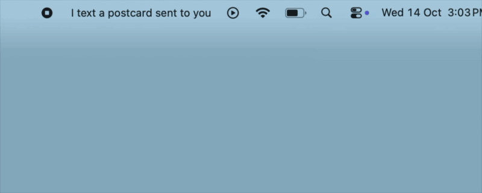

# Helen



A macOS menu bar app that shows the current line of synced lyrics for whatever is playing. Lyrics come from [lrclib](https://lrclib.net).

## Install

Requires macOS 13 or later (Intel and Apple Silicon).

1. Download the latest `Helen-<version>.zip` from [Releases](https://github.com/arungovil/helen/releases) and unzip it.
2. Double-click `Helen.app` to open it. (Optionally move it to Applications first so Spotlight and Launchpad can find it.)
3. macOS will say it can't verify the app, because it isn't notarized. Click **Done**, then open **System Settings → Privacy & Security**, scroll to the Security section and click **Open Anyway**. You only need to do this once.

Or skip the prompt from Terminal:

```
xattr -dr com.apple.quarantine path/to/Helen.app
```

Helen lives in the menu bar. Use its menu to quit.

## Run from source

```
swift run
```

## Credits

<a href="https://www.flaticon.com/free-icons/girl" title="girl icons">Girl icons created by Magnific - Flaticon</a>
